# Qalbu

Qalbu adalah aplikasi chat refleksi Al-Qur'an berbahasa Indonesia. User menulis kondisi
emosional, aplikasi mencari sumber yang relevan dari corpus Quran lokal, lalu model Ollama
menyusun refleksi singkat yang tetap terhubung ke sumber tersebut.

Qalbu bukan alat diagnosis, terapi, fatwa, layanan krisis, atau pengganti manusia tepercaya dan
tenaga profesional.

## Cara kerja



Untuk risiko segera, aplikasi langsung mengirim respons krisis tetap dan tidak memanggil model.
Jika retrieval gagal, sumber tidak cukup relevan, atau jawaban AI tidak lolos validasi, aplikasi
menampilkan fallback jujur atau sources-only response.

Runtime sengaja sederhana: satu bahasa, satu corpus aktif (`qalbu-kemenag-v1`), embedding lokal
(EmbeddingGemma via Ollama), LLM lokal (Qwen via Ollama), dan PostgreSQL + pgvector di mesin yang
sama. Riwayat chat hanya disimpan di `localStorage` browser; server tidak menyimpan percakapan.
lighttpd menjadi pintu depan: static frontend langsung, `/api/*` dan `/dataset*` di-proxy ke
FastAPI.

## Struktur project

| Path | Tanggung jawab |
|---|---|
| `frontend/index.html` | Markup UI chat, Ayat Hari Ini, disclaimer, dan riwayat lokal |
| `frontend/dataset.html` | Katalog referensi ayat corpus aktif |
| `frontend/dataset-detail.html` | Detail ayat, terjemahan, tafsir, dan provenance |
| `frontend/assets/css/` | Token desain dan stylesheet per halaman |
| `frontend/assets/js/` | Modul ES: chat, SSE, Ayat Hari Ini, history, dataset, detail ayat |
| `app/main.py` | Bootstrap FastAPI, lifespan pool, dan static frontend |
| `app/api/routes/chat.py` | Endpoint chat, SSE, timeout, rate limit |
| `app/safety/guardrails.py` | Safety gate sebelum network call |
| `app/rag/pipeline.py` | Orkestrasi safety, retrieval, generation, fallback |
| `app/rag/messages.py` | Semua teks fallback dan batas cakupan |
| `app/rag/responses.py` | Pembentuk response fallback, crisis, dan sources-only |
| `app/rag/retriever.py` | Embedding, threshold, dedup parent |
| `app/providers/embeddings/ollama.py` | Adapter embedding lokal Ollama |
| `app/providers/llm/ollama.py` | Adapter LLM lokal Ollama + JSON schema |
| `app/database/postgres.py` | Pool asyncpg dan codec jsonb |
| `app/database/queries.py` | Vector search dan pembacaan dokumen |
| `app/rag/citation_validator.py` | Validasi provenance dan evidence |
| `app/rag/response_quality.py` | Quality gate dan repair prompt |
| `scripts/kemenag/` | Parser portal, dokumen, cache, DB, dan sinkronisasi Kemenag |
| `db/init/001_schema.sql` | Schema PostgreSQL, pgvector index, dan RPC |
| `deploy/lighttpd/` | Image dan konfigurasi reverse proxy |
| `compose.yaml`, `compose.dev.yaml` | Stack produksi dan override development |
| `tests/` | Test safety, retrieval, provider, API, citation, dan frontend |

Penjelasan alur dan keputusan arsitektur yang lebih lengkap ada di
[`docs/ARCHITECTURE.md`](docs/ARCHITECTURE.md).

## Jalankan lokal (Docker)

Syarat: Docker Desktop/Engine dengan Compose. Model diunduh sekali ke volume `ollama`.

```powershell
Copy-Item .env.example .env
# isi POSTGRES_PASSWORD; DATABASE_URL boleh mengikuti nilai yang sama
docker compose -f compose.yaml -f compose.dev.yaml up -d --build
docker compose exec ollama ollama pull embeddinggemma
docker compose exec ollama ollama pull qwen2.5:3b-instruct
docker compose run --rm qalbu-api python -m scripts.kemenag.sync --manifest data/manifests/kemenag_corpus_verses.json
```

Buka [http://127.0.0.1:8000/](http://127.0.0.1:8000/). Tanpa override dev, jalankan
`docker compose up -d --build`.

Health check:

```powershell
Invoke-WebRequest http://127.0.0.1:8000/api/health
```

`status=ok` berarti proses hidup. `rag=configured` berarti `DATABASE_URL` terbaca; field `corpus`
menunjukkan corpus aktif. Keduanya belum membuktikan tabel corpus berisi data.

Tanpa Docker: butuh Python 3.11+, PostgreSQL 16 + pgvector, dan Ollama di `localhost:11434`.
Setelah `pip install -r requirements.txt`, jalankan `python -m uvicorn app.main:app --port 8000`.

## Deploy VPS (IP, tanpa domain)

Stack ini dirancang untuk satu VPS kecil (4 GB RAM, CPU) dengan akses IP dulu. **Tanpa TLS, isi
chat dan cookie lewat internet terbuka.** Aktifkan HTTPS sebelum dipakai orang lain; `sslip.io`
atau domain sendiri bisa dipakai untuk Let's Encrypt.

```bash
git clone <repo> qalbu && cd qalbu
cp .env.example .env
# APP_ENV=production, ALLOWED_ORIGINS=http://<IP>, QALBU_HTTP_PORT=80,
# OLLAMA_NUM_CTX=2048, REQUEST_TIMEOUT_SECONDS=240
chmod 600 .env
docker compose up -d --build
docker compose exec ollama ollama pull embeddinggemma
docker compose exec ollama ollama pull qwen2.5:3b-instruct
docker compose run --rm qalbu-api python -m scripts.kemenag.sync --manifest data/manifests/kemenag_corpus_verses.json
curl http://127.0.0.1/api/health
```

Firewall: buka hanya 22 dan 80. Port `postgres` dan `ollama` tidak dipublikasikan; `qalbu-api`
hanya ada di jaringan internal Compose. `data/raw/*` di-ignore Git, jadi salin cache scrape ke VPS
(`scp`) atau isi credential Kemenag agar sync mengambil ulang.

Setelah corpus terisi, kalibrasi ulang threshold retrieval (lihat bagian evaluasi). Evaluasi terakhir
pada corpus ini mempertahankan `MIN_RETRIEVAL_SCORE=0.32` untuk EmbeddingGemma: recall@4 `0.601`,
empty rate `0`.

## Konfigurasi

Salin [`.env.example`](.env.example) menjadi `.env`. Isi secret hanya di `.env` atau secret
manager, jangan commit ke Git. Compose meng-override host `postgres`/`ollama` secara internal.

| Variabel | Fungsi |
|---|---|
| `DATABASE_URL` | DSN PostgreSQL lokal untuk runtime non-Docker |
| `POSTGRES_PASSWORD` | Password user `qalbu`; dipakai Compose untuk `DATABASE_URL` |
| `OLLAMA_BASE_URL`, `OLLAMA_MODEL` | Model chat lokal dan alamatnya |
| `OLLAMA_EMBEDDING_MODEL` | Model embedding lokal (default `embeddinggemma`) |
| `OLLAMA_NUM_CTX` | Context window model chat; kecilkan di RAM 4 GB |
| `QALBU_HTTP_PORT` | Port publik lighttpd; `8000` lokal, `80` di VPS |
| `QALBU_CORPUS` | Corpus aktif; default `qalbu-kemenag-v1`, rollback `qalbu-seed-v1` |
| `MIN_RETRIEVAL_SCORE`, `TOP_K_RETRIEVAL`, `RETRIEVAL_PARENT_K` | Batas retrieval |
| `REQUEST_TIMEOUT_SECONDS` | Batas satu permintaan chat; naikkan untuk CPU lambat |
| `ALLOWED_ORIGINS` | Origin frontend yang diizinkan CORS |
| `CRISIS_LINE`, `CRISIS_LINE_LABEL` | Kontak bantuan yang harus diverifikasi |

`TOP_K_RETRIEVAL` adalah jumlah minimum child yang diminta dari vector search. Runtime melakukan
oversampling hingga `max(TOP_K_RETRIEVAL, RETRIEVAL_PARENT_K * 4)` agar beberapa child dari satu
parent tidak menghabiskan seluruh slot sebelum parent unik lain ditemukan. RPC tetap membatasi
hasil maksimal 100 child.

## API

### `GET /api/health`

Mengembalikan status proses dan status konfigurasi RAG.

### `POST /api/v1/chat`

Request:

```json
{"message":"Aku merasa hampa"}
```

Response berupa Server-Sent Events dengan event `response`, `crisis`, `error`, dan `done`.
Routing intent deterministik membedakan refleksi emosional, informasi Al-Qur'an, panduan Islam,
panduan praktis, informasi umum, dan out-of-scope. Safety selalu dijalankan lebih dulu; intent
non-Quran berhenti sebelum embedding, retrieval, atau LLM. Event `response` membawa `mode`
(`grounded_reflection`, `sources_only`, `scope_limit`, atau `crisis`) dan `reason_code` bila jalur
tidak normal.

### `GET /api/v1/dataset/verse-of-day`

Mengembalikan satu ayat deterministik dari seluruh corpus aktif. Pemilihan memakai tanggal
`Asia/Jakarta`, sehingga ayat berganti pukul 00:00 WIB dan sama untuk semua pengguna pada hari
yang sama. Endpoint ini hanya membaca PostgreSQL; tidak memanggil embedding, LLM, atau retrieval.

Homepage menampilkan hasilnya sebagai bar ringkas **Ayat Hari Ini**. Link `Buka ayat` menuju
`/dataset/verse/{surah}/{ayah}` dan halaman detail mengambil teks dari corpus aktif.

Jika database atau provenance sumber tidak tersedia, UI menampilkan error kecil dengan tombol
retry. Tidak ada ayat hardcoded sebagai fallback.

## Data dan provenance

Runtime membaca corpus yang dipilih `QALBU_CORPUS` dari tabel `quran_documents` dan `quran_chunks`
di PostgreSQL lokal. Folder [`data/external/indonesian-quran/`](data/external/indonesian-quran/)
hanya menyimpan snapshot/seed referensi dan tidak dibaca langsung oleh chat runtime.

Sumber aktif corpus `qalbu-kemenag-v1` adalah [API Al-Qur'an Kemenag](https://quran-api.lpmqkemenag.id/alquran/data)
dari LPMQ Kementerian Agama RI. Metadata `source_provider=official_portal` dan
`source_authority=LPMQ Kementerian Agama RI` dipakai untuk menampilkan provenance ini di UI.
Evidence Arab, terjemahan, tafsir, dan provenance yang dikirim ke UI berasal dari row database,
bukan dibuat oleh model. Snapshot di folder data tetap diperlakukan terpisah dan tidak otomatis
dianggap sebagai sumber resmi.

Inventaris referensi lengkap tersedia di [`docs/QURAN_DATASET.md`](docs/QURAN_DATASET.md) dan
halaman web [`/dataset`](http://127.0.0.1:8000/dataset). Setiap ayat adalah satu parent; field
Arab, terjemahan, tafsir, dan tema dibuat sebagai child embedding terpisah.

Indexing corpus dilakukan lewat `scripts.kemenag.sync` dan tidak dijalankan otomatis saat server
boot. Endpoint katalog menghitung child dari row database aktual; tanpa koneksi database, nilai
manifest hanya fallback offline. Model serta dimensi embedding saat indexing harus sama dengan
runtime (`768` dimensi).

Taxonomy kondisi emosional ada di
[`data/manifests/mental_health_categories.json`](data/manifests/mental_health_categories.json).
Label yang sudah memiliki ayat dapat disinkronkan dengan
`python -m scripts.sync_mental_health_categories`; jalankan `--dry-run` untuk memeriksa snapshot
lebih dulu. Kategori keselamatan hanya melewati safety guardrail.

## Verifikasi

```powershell
python -m pytest -q
python -m ruff check .
python -m mypy app
```

## Evaluasi retrieval

```powershell
python -m evaluation.retrieval_eval --json evaluation/retrieval-report.json
```

Membangun ulang 282 ayat Kemenag dari `data/raw/kemenag_corpus_verses_scrape.json`,
meng-embed child chunk dengan Ollama, lalu menjalankan `QuranRetriever` yang sama secara in-memory
(tanpa database). Label query ada di [`evaluation/retrieval_cases.json`](evaluation/retrieval_cases.json);
metrik dipisah antara routing (`classify_intent`), ranking, dan end-to-end. Embedding di-cache di
`evaluation/.cache/`; pakai `--refresh` setelah corpus atau model berubah. Angka latensi adalah
proxy cosine Python, bukan pgvector produksi.

## Batasan MVP

- Coverage dan relevansi bergantung pada isi corpus serta kualitas embedding.
- Model 3b di CPU bisa lambat dan sering gagal quality gate, sehingga jatuh ke sources-only.
- Cache dan rate limiter hanya berlaku dalam satu proses; jalankan satu worker.
- Tidak ada authentication, server-side history, reranker, atau dashboard evaluasi.
- Kontak krisis harus diverifikasi sebelum digunakan.
- Tanpa TLS, akses lewat IP publik tidak terenkripsi.

## Lisensi

Project ini dirilis di bawah [MIT License](LICENSE).
