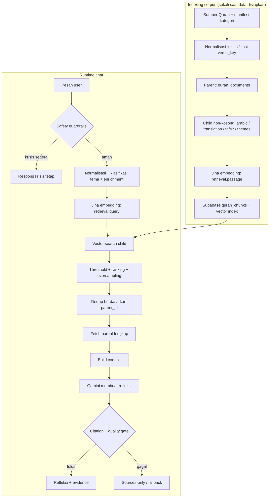

# Qalbu

Qalbu adalah aplikasi chat refleksi Al-Qur'an berbahasa Indonesia. User menulis kondisi
emosional, aplikasi mencari sumber yang relevan dari corpus Quran di Supabase, lalu Gemini
menyusun refleksi singkat yang tetap terhubung ke sumber tersebut.

Qalbu bukan alat diagnosis, terapi, fatwa, layanan krisis, atau pengganti manusia tepercaya dan
tenaga profesional.

## Cara kerja



Untuk risiko segera, aplikasi langsung mengirim respons krisis tetap dan tidak memanggil Jina
atau Gemini. Jika retrieval gagal, sumber tidak cukup relevan, atau jawaban AI tidak lolos
validasi, aplikasi menampilkan fallback jujur atau sources-only response.

Runtime MVP sengaja sederhana: satu bahasa, satu corpus aktif (`qalbu-kemenag-v1`), satu provider
embedding (Jina), dan satu provider LLM (Gemini). Riwayat chat hanya disimpan di `localStorage`
browser; server tidak menyimpan percakapan.

## Struktur project

| Path | Tanggung jawab |
|---|---|
| `frontend/index.html` | UI chat, pembaca SSE, evidence Quran, history lokal |
| `frontend/dataset.html` | Katalog referensi ayat corpus aktif |
| `app/main.py` | Bootstrap FastAPI dan static frontend |
| `app/api/routes/chat.py` | Endpoint chat, SSE, timeout, rate limit |
| `app/safety/guardrails.py` | Safety gate sebelum network call |
| `app/rag/pipeline.py` | Orkestrasi safety, retrieval, generation, fallback |
| `app/rag/retriever.py` | Embedding, threshold, dedup parent |
| `app/providers/embeddings/jina.py` | Adapter Jina embeddings |
| `app/providers/llm/gemini.py` | Adapter Gemini structured JSON |
| `app/rag/citation_validator.py` | Validasi provenance dan evidence |
| `app/rag/response_quality.py` | Quality gate dan repair prompt |
| `supabase/migrations/` | Schema, pgvector index, RPC, dan akses server-only |
| `tests/` | Test safety, retrieval, provider, API, citation, dan frontend |

Penjelasan alur dan keputusan arsitektur yang lebih lengkap ada di
[`docs/ARCHITECTURE.md`](docs/ARCHITECTURE.md).

## Jalankan lokal

Syarat: Python 3.11+, corpus `qalbu-kemenag-v1` sudah terisi di Supabase, dan credential provider.

```powershell
python -m venv .venv
.\.venv\Scripts\Activate.ps1
pip install -r requirements.txt
Copy-Item .env.example .env
python -m uvicorn app.main:app --host 127.0.0.1 --port 8000
```

Buka [http://127.0.0.1:8000/](http://127.0.0.1:8000/).

Docker:

```powershell
docker compose up --build
```

Health check:

```powershell
Invoke-WebRequest http://127.0.0.1:8000/api/health
```

`status=ok` berarti proses hidup. `rag=configured` hanya berarti credential server terbaca; field
`corpus` menunjukkan corpus aktif. Keduanya belum membuktikan corpus Supabase berisi data.

## Konfigurasi

Salin [`.env.example`](.env.example) menjadi `.env`. Isi secret hanya di `.env` atau secret
manager, jangan commit ke Git.

| Variabel | Fungsi |
|---|---|
| `GEMINI_API_KEY`, `GEMINI_MODEL` | Membuat refleksi grounded |
| `JINA_API_KEY`, `JINA_EMBEDDING_MODEL` | Membuat query embedding |
| `SUPABASE_URL`, `SUPABASE_SECRET_KEY` | Akses database/vector search dari server |
| `QALBU_CORPUS` | Corpus aktif; default `qalbu-kemenag-v1`, rollback `qalbu-seed-v1` |
| `MIN_RETRIEVAL_SCORE`, `TOP_K_RETRIEVAL`, `RETRIEVAL_PARENT_K` | Batas retrieval |
| `CRISIS_LINE`, `CRISIS_LINE_LABEL` | Kontak bantuan yang harus diverifikasi |

`SUPABASE_SERVICE_ROLE_KEY` masih diterima untuk kompatibilitas lama, tetapi key server tidak boleh
dikirim ke browser.

`TOP_K_RETRIEVAL` adalah jumlah minimum child yang diminta dari vector search. Runtime melakukan
oversampling hingga `max(TOP_K_RETRIEVAL, RETRIEVAL_PARENT_K * 4)` agar beberapa child dari satu
parent tidak menghabiskan seluruh slot sebelum parent unik lain ditemukan. RPC tetap membatasi
hasil maksimal 100 child.

## API

### `GET /api/health`

Mengembalikan status proses dan status konfigurasi RAG.

### `POST /api/v1/chat`

Request:

```json
{"message":"Aku merasa hampa"}
```

Response berupa Server-Sent Events dengan event `response`, `crisis`, `error`, dan `done`.

## Data dan provenance

Runtime membaca corpus yang dipilih oleh `QALBU_CORPUS` dari tabel Supabase `quran_documents` dan `quran_chunks`.
Folder [`data/external/indonesian-quran/`](data/external/indonesian-quran/) hanya menyimpan
snapshot/seed referensi dan tidak dibaca langsung oleh chat runtime.

Sumber aktif corpus `qalbu-kemenag-v1` adalah [API Al-Qur'an Kemenag](https://quran-api.lpmqkemenag.id/alquran/data)
dari LPMQ Kementerian Agama RI. Metadata `source_provider=official_portal` dan
`source_authority=LPMQ Kementerian Agama RI` dipakai untuk menampilkan provenance ini di UI.
Evidence Arab, terjemahan, tafsir, dan provenance yang dikirim ke UI berasal dari row database,
bukan dibuat oleh Gemini. Snapshot di folder data tetap diperlakukan terpisah dan tidak otomatis
dianggap sebagai sumber resmi.

Inventaris referensi lengkap tersedia di [`docs/QURAN_DATASET.md`](docs/QURAN_DATASET.md) dan
halaman web [`/dataset`](http://127.0.0.1:8000/dataset). Setiap ayat adalah satu parent;
field Arab, terjemahan, tafsir, dan tema dibuat sebagai child embedding terpisah.

Indexing corpus dilakukan terpisah dan tidak dijalankan otomatis saat server boot. Endpoint katalog
menghitung child dari row Supabase aktual ketika credential server tersedia; tanpa koneksi database,
nilai manifest hanya fallback offline. Model serta
dimensi embedding saat indexing harus sama dengan runtime (`768` dimensi).

Taxonomy kondisi emosional ada di
[`data/manifests/mental_health_categories.json`](data/manifests/mental_health_categories.json).
Daftar ayat yang dikelompokkan agar mudah dibaca tersedia di
[`docs/VERSE_CATEGORIES.md`](docs/VERSE_CATEGORIES.md).
Seluruh 201 ayat pada inventaris retrieval Kemenag memiliki setidaknya satu
kategori kandidat refleksi; satu ayat dapat muncul di beberapa kategori.
Label yang sudah memiliki ayat Kemenag dapat disinkronkan ke Supabase dengan
`python -m scripts.sync_mental_health_categories`; jalankan `--dry-run` untuk memeriksa snapshot
lebih dulu. Kategori keselamatan hanya melewati safety guardrail. Kategori tanpa ayat aktif tetap
ditandai pending sampai data diambil dan diverifikasi dari [API Al-Qur'an Kemenag](https://quran-api.lpmqkemenag.id/alquran/data).

Daftar ayat dan tafsir tambahan yang diminta tersedia di
[`data/manifests/kemenag_reflection_verses.json`](data/manifests/kemenag_reflection_verses.json).
Gunakan `python -m scripts.scrape_kemenag_manifest --dry-run` untuk melihat ayat yang belum ada.
Setelah credential Kemenag diisi di `.env`, jalankan `python -m scripts.scrape_kemenag_manifest`.
Daftar hasil retrieval yang sudah diverifikasi dapat dilihat di
[`data/manifests/kemenag_retrieved_verses.json`](data/manifests/kemenag_retrieved_verses.json).

## Verifikasi

```powershell
python -m pytest -q
python -m ruff check app tests
python -m mypy app
```

## Batasan MVP

- Coverage dan relevansi bergantung pada isi corpus serta kualitas embedding.
- Cache dan rate limiter hanya berlaku dalam satu proses.
- Tidak ada authentication, server-side history, reranker, atau dashboard evaluasi.
- Kontak krisis harus diverifikasi sebelum digunakan.
- Latency bergantung pada Jina, Supabase, Gemini, dan kapasitas proses.

## Lisensi

Project ini dirilis di bawah [MIT License](LICENSE).
